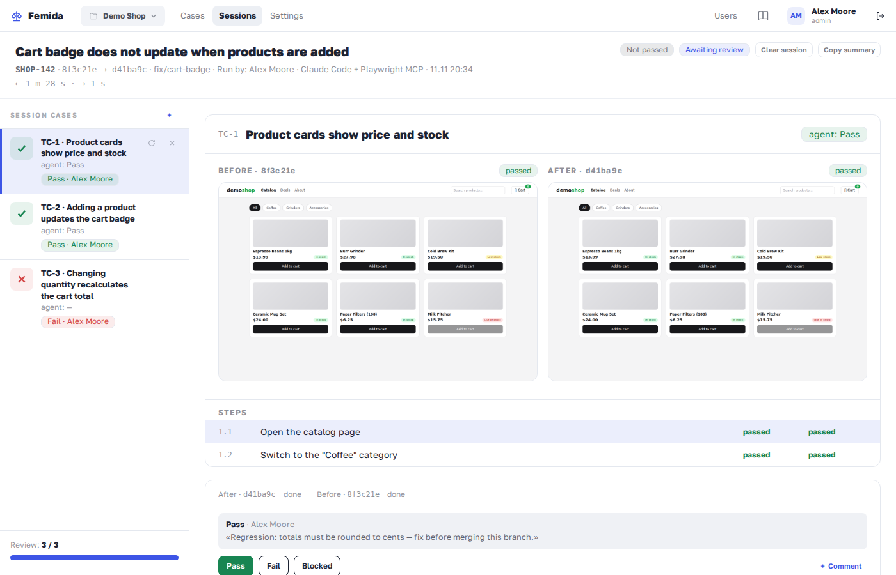
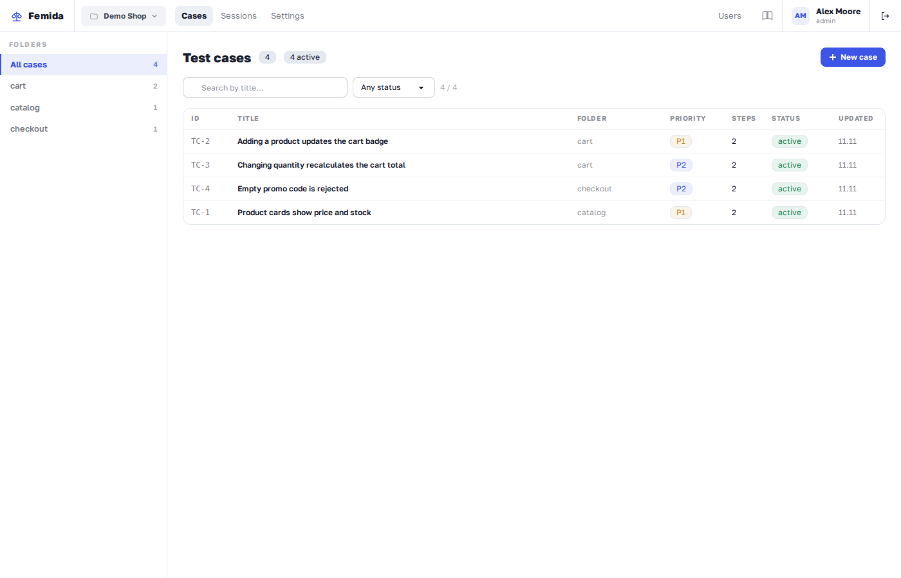
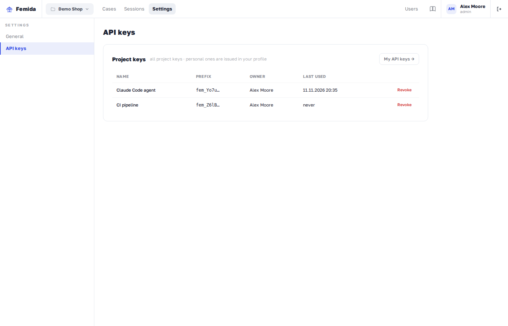

# Femida

Self-hosted QA evidence service: an AI agent runs your test cases on the base and
head commits of a task, uploads **before/after screenshot pairs** for every step,
and a human tester reviews the pairs and gives the final verdict.

## How it works

1. Test cases live in Femida as a reusable project library (steps: action + expected).
2. A developer finishes a task and tells their chat agent (e.g. Claude Code +
   Playwright MCP) to "test and record". The agent runs **locally**: boots the app
   in git worktrees for both commits, walks the selected cases step by step, takes
   screenshots and uploads them to Femida with a suggested verdict.
3. The tester opens the session, looks at the before/after pairs and presses a
   verdict: pass / fail / blocked. A markdown summary is copy-pasted into the tracker.



The server is a hub only: it never needs access to your repositories.

## Stack

- PHP 8.4, Laravel, Livewire, SQLite (single FrankenPHP container)
- Tailwind CSS v4 + daisyUI (custom `femida` theme)
- REST API v1 + MCP server (project-scoped API keys)
- Roles: instance admin · project owner (settings, team) · developer (own projects) · tester (cases, verdicts)
- UI in English and Russian; screenshots stay on your disk, nothing is ever
  auto-deleted

## Quick start

```bash
docker compose up -d --build
# open http://localhost:8080 — first run shows the setup wizard
```

Then:

1. The admin creates a project (and, if needed, other users with roles).
   Cases live in a reusable library, grouped into folders:

   

2. In project settings issue an API key — it is shown **once**.

   

3. Point your agent at Femida with `FEMIDA_URL` + `FEMIDA_KEY` (see
   [docs/skill.md](docs/skill.md)) and ask it to test and record.
4. Review the session: before/after pairs, give a verdict (pass / fail /
   blocked), copy the markdown summary into the tracker.

Your tested repository needs a small [`femida.yaml`](docs/femida-yaml.md) describing how
to boot the app; the agent reads it from the commit under test.

## Documentation

- [Deployment](docs/deploy.md) — install, environment, updates, backups
- [Writing the agent skill](docs/skill.md) — the v1 contract for a hand-written skill
- [`femida.yaml` reference](docs/femida-yaml.md) — how Femida boots your app
- [Security model](docs/security.md) — keys, roles, privacy

## Development (Docker-only, no local PHP required)

```bash
make up                 # build & run
make composer CMD="install"
make npm CMD="install"
make migrate
make test               # PHPUnit
make artisan CMD="…"    # any artisan command
```

## Repository layout

```
app/               domain code: Http (REST), Mcp (tools), Livewire components, Models, Services
routes/            REST, MCP and web routes
resources/views/   Livewire views (review screen, case library, …)
lang/              ru/en UI dictionaries
docker/            FrankenPHP Dockerfile, Caddyfile, entrypoint
docs/              public documentation
tests/             PHPUnit feature tests
```

Standard Laravel layout otherwise: the repo root is the project root
(composer.json, artisan, config/, … at the top level).

## Support

Femida is free and open source. If it saves your team testing time, you can
support the development:

[](https://pay.cloudtips.ru/p/1aef058c)

(Russian bank cards, ₽.)

## License

[MIT](LICENSE)
